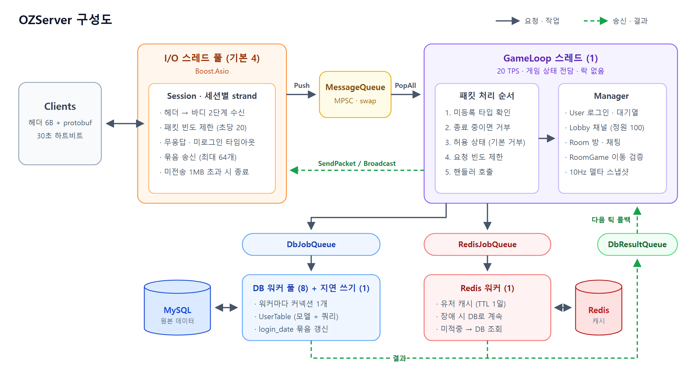

# OZServer

C++20 TCP 게임 룸 서버. **Boost.Asio** 비동기 I/O, **Protobuf** 패킷, **MySQL**(X DevAPI) 저장, **Redis** 캐시.
로그인 → 로비(채널) → 방 생성/참가 → 채팅 → 방 게임(서버 권한 이동 검증 + 10Hz 델타 스냅샷)까지의 서버 뼈대를 멀티스레드 구조와 부하 측정으로 검증한 포트폴리오 프로젝트입니다(게임 컨텐츠는 의도적으로 제외).

포트폴리오 문서(PDF): [`NetworkServer/OZServer/portfolio.pdf`](NetworkServer/OZServer/portfolio.pdf)

---

## 구성도



- **스레드 분리**: 소켓 작업은 세션별 strand, 게임 상태는 GameLoop 스레드 하나에서만 바꿉니다. 두 쪽은 MPSC `MessageQueue`(swap으로 한 번에 꺼냄)로만 만나므로, 방·유저 상태에는 락이 없습니다.
- **DB/Redis도 같은 원칙**: GameLoop는 직접 쿼리하지 않고 작업을 큐에 넣습니다. 결과는 다음 틱에 GameLoop 스레드에서 콜백으로 받습니다.

## 구조

```
Sample/
├── NetworkServer/
│   ├── OZServer/          서버 (OZServer.sln)
│   │   ├── Network/       패킷 헤더·디스패처·FSM 정책·접속 제한
│   │   ├── Session/       세션(strand, 송수신, 타임아웃), 세션 관리
│   │   ├── Message/       MessageQueue (I/O → GameLoop)
│   │   ├── User/ Lobby/ Room/   로그인·대기열 / 로비 채널 / 방·방 게임(RoomGame)
│   │   ├── Db/ Redis/     DB 워커 풀·지연 쓰기 / Redis 워커·유저 캐시
│   │   ├── Data/          테이블별 모델 + 쿼리(DAO)
│   │   ├── Common/        로거, 설정, 레이트리밋, 틱 통계, 종료 정책
│   │   └── GameLoop.h  main.cpp
│   ├── db/schema.sql      MySQL 스키마
│   └── docker-compose.yml MySQL + Redis
├── Client/                콘솔 테스트 클라이언트
├── C#/                    웹소켓 채팅 서버 (ASP.NET Core, Redis Pub/Sub)
├── Python/  PHP/          게임 컨텐츠 로직 · 운영 도구 코드 샘플
├── docs/images/           구성도 이미지
├── proto/                 .proto 정의 + build.bat(생성·복사)
└── Scripts/               vcxproj filters 재생성
```

## 테스트와 검증

단위 테스트(ServerTest)와 부하 테스트 봇(LoadTest) 코드는 저장소에 포함하지 않았고, 결과만 정리했습니다.

**부하 측정** (Release, 서버·봇 같은 PC, 자체 부하 봇 LoadTest)

| 시나리오 | 결과 |
|---|---|
| 동시 접속 6,000명, 10명 방, 1초마다 채팅 | 실패 0, 채팅 왕복 p50 50ms / **p99 114ms**, 초당 59,447건 수신 |
| 방 게임 6,000명 (10명 방, 봇마다 100ms 주기 이동, 10%는 순간이동 시도) | 실패 0, 이동→스냅샷 반영 p50 74ms / **p99 144ms**, 정상 이동 거부 0, 순간이동 거부 36,583/36,609(나머지는 측정 종료·판 종료로 거부 응답 미집계), 틱 평균 7.8ms |
| 접속→로그인→방→퇴장→로그아웃 반복 300봇 | 초당 **400 사이클**, 오류 0, 종료 후 세션 누수 0 |
| 6,000명 동시 로그인 | p99 9.4s → **2.5s**(Redis 캐시 적중 시 DB 쿼리 0건) |
| 개선 전 → 후 | 통과 인원 2,000 → 6,000명, 서버 전달량 2.6만 → 24.7만 패킷/초 |

- **단위 테스트 (Google Test 109개)**: 패킷 프레이밍·디스패처(허용 상태·빈도 제한 등록), 레이트리밋, 로그인 대기열, 채널 배정, 방 게임 규칙(단계 전환·이동 검증·델타 스냅샷), 설정 파싱, 로거, 지연 쓰기 버퍼, 종료 정책, 큐 동시성.
- **핸들러 동작**: `UserManager`/`RoomManager`/`LobbyManager` 핸들러는 실제 소켓 연결이 필요해 단위 테스트 대신 아래 방법으로 검증합니다.
  - **LoadTest 시나리오**: 6,000명 방 채팅·방 게임, 반복 접속·종료, 동시 로그인, 로비 채널.
  - **소켓 시나리오 확인**: 캐시 적중·만료·Redis 정지 시 동작, 중복 로그인, 종료 중 요청 거부, 게임 단계·진행 중 입장 거부·이동 보정 등.

## 다른 언어 샘플

| 폴더 | 내용 |
|---|---|
| **C#** | ASP.NET Core 웹소켓 채팅 서버. 여러 서버가 Redis Pub/Sub으로 채널을 공유하고, 세션 인증·빈도 제한·느린 클라이언트 차단·길드 채팅 기록을 처리합니다. |
| **Python** | 게임 컨텐츠 샘플: 퀘스트, 소환, 이벤트(랭킹·패스·교환 상점), 스킬. 확인·차감·지급을 한 트랜잭션으로 처리합니다. |
| **PHP** | 카드 강화·승급, 전투 정산, 설정으로 만드는 운영 도구 조회 화면 샘플(PHP 8.1 이상). |
